<div align="center">

# Mathigram (수식그램)

**수식으로 그리고, 그림을 수식으로.**

이란의 수학자 Hamid Naderi Yeganeh는 수만 개의 곡선을 정의하는 수식만으로 얼굴·동물 같은 구체적인 그림을 그려낸다.
Mathigram은 이 아이디어를 iPhone에서 양방향으로 체험하는 앱이다 — 수식을 쓰면 그림이 나오고, 사진을 넣으면 그 윤곽을 근사하는 실제 수식이 나온다.

[-black?logo=apple)](#요구-사항)
[](#)
[](#)
[](LICENSE)

</div>

---

## 목차

- [이게 뭔가요](#이게-뭔가요)
- [진행 상황](#진행-상황)
- [Phase 0 — 프로젝트 기반](#phase-0--프로젝트-기반)
- [Phase 1 — 수식 엔진](#phase-1--수식-엔진)
- [Phase 2 — 그리기 모드](#phase-2--그리기-모드)
- [Phase 3 — 변환 모드](#phase-3--변환-모드)
- [요구 사항](#요구-사항)
- [프로젝트 구조](#프로젝트-구조)
- [라이선스](#라이선스)

## 이게 뭔가요

Mathigram은 두 가지 방향의 변환을 제공하는 iPhone 전용 앱이다.

1. **그리기 (수식 → 그림)**: 매개변수 `t`와 레이어 인덱스 `k`에 대한 수식 `x(t,k)`, `y(t,k)`를 입력하면, 앱이 `k`에 대해 수백~수천 번 반복해 곡선을 겹쳐 그린다. 선 하나하나가 모여 하나의 그림이 된다.
2. **변환 (그림 → 수식)**: 사진을 가져오면 Vision으로 윤곽을 추출하고, 이산 푸리에 변환(DFT)으로 그 윤곽을 근사하는 실제 삼각함수 급수 `x(t) = Σ rₖ·cos(kt+φₖ)`를 계산해 보여준다. 항의 개수를 조절하면 그림이 단순해지거나 원본에 가까워진다.

자세한 기능 요구사항은 [`Docs/PRD-Mathigram.md`](Docs/PRD-Mathigram.md), 진행 상황은 [`Docs/TASKS-Mathigram.md`](Docs/TASKS-Mathigram.md)에 있다.

## 진행 상황

| Phase | 내용 | 상태 |
|---|---|:-:|
| 0 | 프로젝트 기반 (문서·타깃 설정·탭 스켈레톤) | ✅ |
| 1 | 수식 엔진 (렉서/파서/평가기) | ✅ |
| 2 | 그리기 모드 (수식 → 그림) | ✅ |
| 3 | 변환 모드 (그림 → 수식) | ✅ |
| 4 | 갤러리 & 설정 | ⬜️ |
| 5 | 검증 및 마무리 | ⬜️ |

## Phase 0 — 프로젝트 기반

4개 탭(그리기·변환·갤러리·설정)의 뼈대를 세우고, 타깃을 iPhone 전용(iOS 27)으로 설정했다. `그리기` 탭은 다음 단계에 들어올 수식 엔진 자리에 데모용 하트 곡선(`x(t)=16sin³t`, `y(t)=13cos t − 5cos2t − 2cos3t − cos4t`)을 그려 전체 파이프라인의 모양을 먼저 보여준다.

<div align="center">
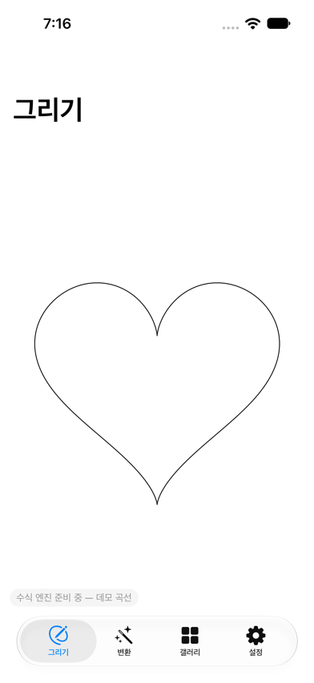
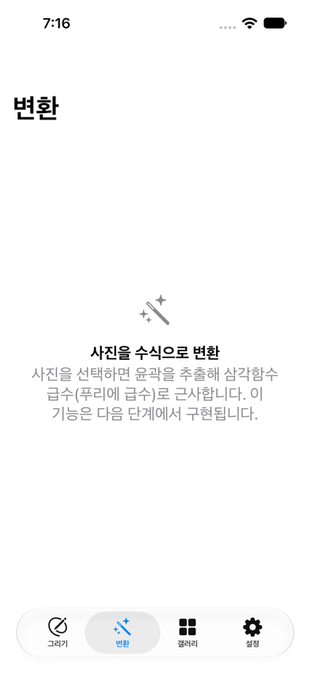
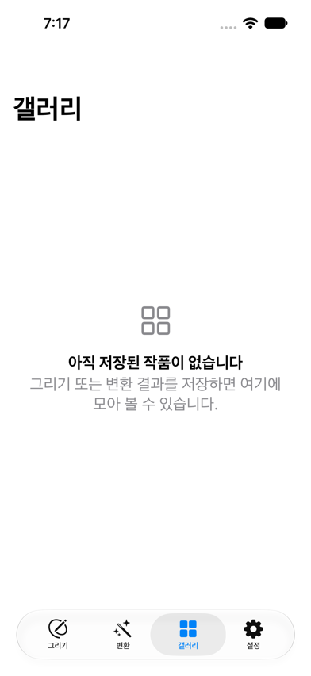
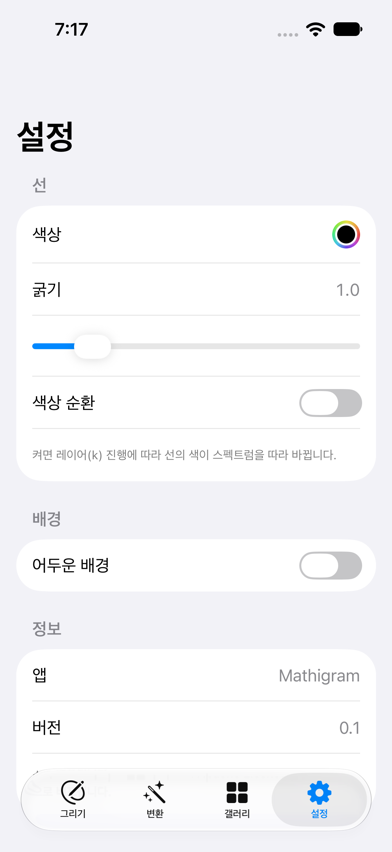
<br/>
<sub>iPhone 16 시뮬레이터(iOS 27) · 그리기 / 변환 / 갤러리 / 설정</sub>
</div>

- **그리기**: `Canvas` 기반 렌더러 자리에 데모 곡선을 그려 디자인을 먼저 고정했다.
- **변환**: 사진 선택·윤곽 추출·푸리에 근사는 Phase 3에서 구현된다.
- **갤러리**: SwiftData 저장소는 Phase 4에서 연결된다.
- **설정**: 선 색상·굵기·색상 순환·배경 토글은 이미 실제로 동작하며, `그리기`/`변환` 캔버스가 공유할 `RenderSettings` 모델에 바로 반영된다.

## Phase 1 — 수식 엔진

`그리기`/`변환` 두 모드가 공유할 **MathEngine**을 추가했다. 사용자가 입력하는 `x(t,k)`, `y(t,k)` 같은 문자열을 임의 코드 실행 없이 안전하게 해석·평가하는 자체 렉서/파서/평가기다.

- **렉서/파서**: 숫자·식별자·`+ - * / ^`·괄호·쉼표를 토큰화하고, `+ -` < `* /` < 단항 `-` < `^`(우결합) 우선순위로 재귀 하강 파싱한다. 모든 구문 오류는 열(column) 번호를 포함한다.
- **평가기**: 변수 `t`(매개변수) · `k`(레이어 인덱스) · `n`(총 레이어 수)과 상수 `pi` · `e`, 함수 `sin cos tan asin acos atan atan2 sqrt abs exp log min max floor ceil round`을 지원한다. 0으로 나누기·`sqrt`의 음수 인자·정의되지 않은 변수는 즉시 오류로 보고한다.
- **LayeredFormula**: 하나의 수식을 `k = 0 … kCount-1`만큼 반복해 겹쳐진 폴리라인 배열로 만든다 (레이어 최대 4,000개 · 레이어당 샘플 최대 400개로 자동 클램프) — Naderi Yeganeh 스타일 "수천 개 선으로 이루어진 그림" 기법의 핵심이다.
- **FormulaFormatter**: 입력 문자열을 `pi → π`, `sqrt → √`, `* → ·` 같은 읽기 쉬운 수학 표기로 바꾼다.

새 `MathigramTests` 타깃(Swift Testing)에 렉서·파서·평가기·LayeredFormula·포매터를 검증하는 테스트 15개를 추가했고 전부 통과한다. 아직 화면에 연결되지 않은 순수 엔진 단계라 새 스크린샷은 없다 — Phase 2에서 `그리기` 탭이 이 엔진으로 실시간 렌더링을 하면 눈에 보이는 변화가 생긴다.

```bash
# Xcode에서 Cmd+U, 또는 커맨드라인에서
xcodebuild test -scheme MyApp -destination 'platform=iOS Simulator,name=iPhone 16'
```

## Phase 2 — 그리기 모드

`그리기` 탭이 Phase 1의 MathEngine으로 실제로 동작한다. `x(t,k)`, `y(t,k)` 두 식을 입력하면 450ms 뒤 백그라운드에서 평가되어 Canvas에 그려지고, 10개 프리셋 중 하나를 고르면 즉시 그 수식과 그림으로 바뀐다.

<div align="center">
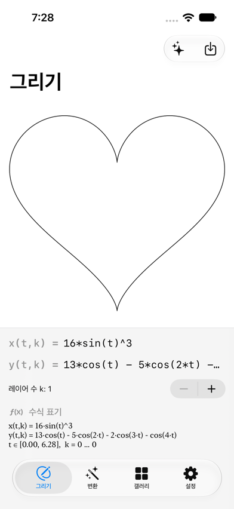
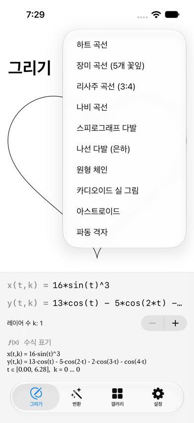
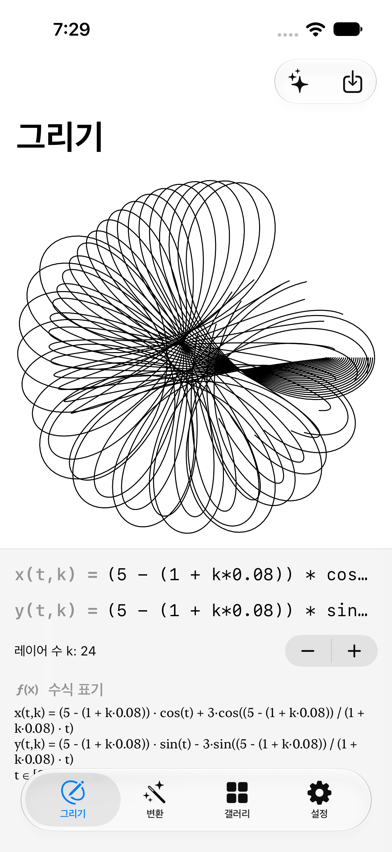
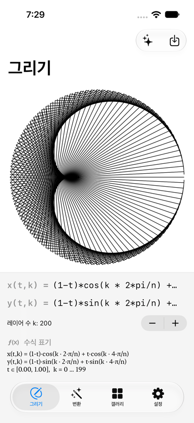
<br/>
<sub>iPhone 16 시뮬레이터(iOS 27) · 하트 곡선 / 프리셋 메뉴 / 스피로그래프 다발(24겹) / 카디오이드 실 그림(직선 200개)</sub>
</div>

- **수식 입력 → 즉시 그림**: 단일 곡선(하트·장미·리사주·나비·아스트로이드)은 `k`가 1인 LayeredFormula로, 레이어드 작품(스피로그래프 다발·나선 다발·원형 체인·카디오이드 실 그림·파동 격자)은 `x(t,k)`, `y(t,k)`가 `k`에 따라 달라지는 수백 겹의 곡선/직선으로 그려진다.
- **카디오이드 실 그림**은 원 위의 점 `k`와 `2k`를 잇는 직선 200개만으로 카디오이드 곡선을 만드는 전통 실 그림(string art) 기법을 그대로 구현한 것이다 — 직선만 모여도 곡선이 "보이는" 좋은 예시다.
- **레이어 수 조절**: Stepper로 `k`를 1~4,000까지 바꾸면 그림이 바로 다시 그려진다 (MathEngine이 레이어 4,000개·레이어당 샘플 400개로 자동 클램프하므로 큰 값을 넣어도 멈추지 않는다).
- **수식 표기 패널**과 **오류 배너**: 수식을 잘못 입력하면(괄호 불일치, 정의되지 않은 변수 등) 캔버스는 마지막 성공 결과를 유지한 채 빨간 배너로 오류를 보여준다.
- **저장**: 우측 상단 저장 버튼이 현재 캔버스를 PNG로 사진 앱에 저장한다.

## Phase 3 — 변환 모드

`변환` 탭은 "**내가 그린 그림이나 촬영된 사진은 어떤 수식들의 조합으로 이루어졌을까?**"라는 질문에 답한다. 입력은 두 가지다 — 사진을 고르거나, 손가락으로 직접 윤곽을 그린다. 둘 다 같은 파이프라인으로 들어간다: 윤곽을 등간격 점으로 리샘플링 → 이산 푸리에 변환(DFT)으로 분해 → 진폭이 큰 순서로 항을 정렬 → 상위 K개 항만 더해 곡선을 다시 그린다. 이건 꾸며낸 연출이 아니라 실제로 동작하는 수학이다: 항을 늘릴수록 재구성된 곡선은 원본에 더 가까워진다.

<div align="center">
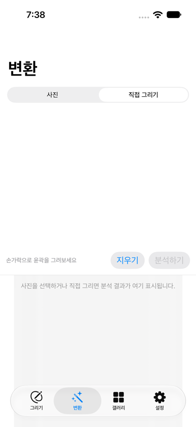
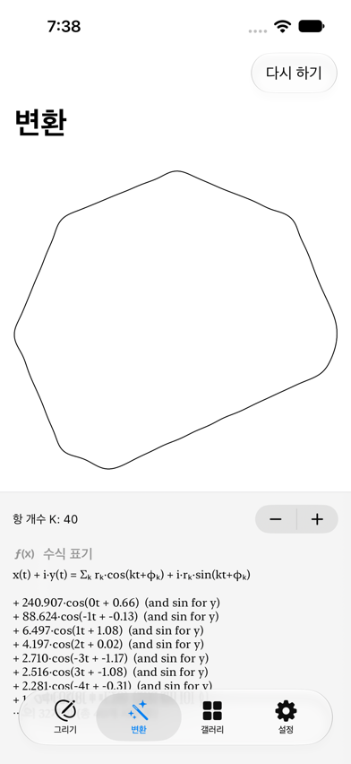
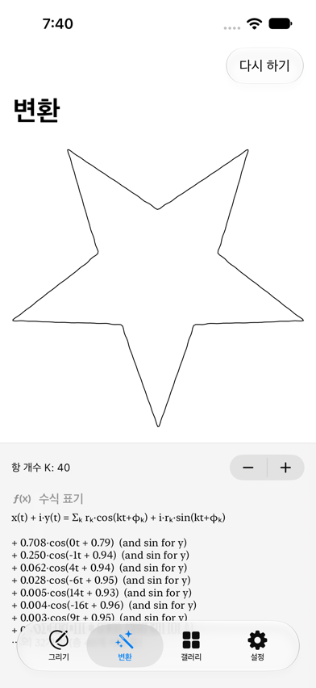
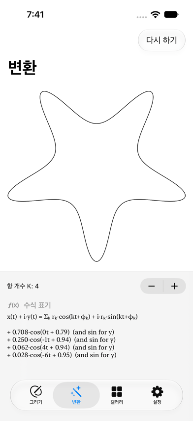
<br/>
<sub>iPhone 16 시뮬레이터(iOS 27) · 직접 그리기 입력 / 스케치 재구성 / 별 사진 40항 재구성 / 같은 사진 4항 재구성</sub>
</div>

- **두 가지 입력**: `사진` 모드는 `PhotosPicker`로 고른 이미지를 Vision의 `DetectContoursRequest`(iOS 27 Swift 동시성 API)로 윤곽을 찾는다. `직접 그리기` 모드는 손가락으로 그린 선을 그대로 윤곽으로 쓴다 — Vision을 거치지 않고 같은 `FourierFit` 파이프라인에 바로 들어간다.
- **진짜 이산 푸리에 변환**: `FourierFit`이 윤곽점을 복소수로 보고 DFT를 계산해 `rₖ, φₖ, k` 삼중항(진폭·위상·주파수) 최대 200개를 진폭 순으로 정렬해 둔다. "항 개수 K" 스테퍼를 움직이면 그중 상위 K개만 합산해 `x(t)=Σrₖcos(kt+φₖ)`, `y(t)=Σrₖsin(kt+φₖ)`로 즉시 다시 그린다 — 스크린샷에서 보듯 별 모양은 40항이면 뾰족한 끝까지 정확하고, 4항이면 둥글게 뭉개진 "원형 원시별"이 된다.
- **수식 표기 패널**: 상위 8개 항을 `k, r, φ` 표로 보여주고 나머지는 "외 N개 항"으로 요약한다.
- 레이어드 수식(Phase 2의 `LayeredFormula`)과 달리, 푸리에 재구성은 여러 곡선을 겹쳐 그리는 게 아니라 **여러 항을 하나의 곡선으로 합산**하는 것이라 전용 `FourierSeries` 타입으로 구현했다 — `MathCanvasRenderer`의 화면 맞춤(fit) 로직만 공유한다.
- `FourierFit`/`PolylineResampler`에 대한 단위 테스트 4개를 추가했다(단위원을 근사하면 지배항이 `k=±1, r≈1`이 되는지, 항을 늘리면 재구성 오차가 실제로 줄어드는지 검증) — 전체 19개 테스트 통과.

## 요구 사항

- Xcode (iOS 27 SDK 포함)
- iPhone 16 시뮬레이터 (또는 실제 iPhone, iOS 18+)

```bash
open "Untitled Project.xcodeproj"
```

실행 대상을 **iPhone 16** 시뮬레이터로 선택하고 `Cmd + R`로 빌드·실행한다.

## 프로젝트 구조

```
MyApp/
├─ MyApp.swift, ContentView.swift      # 4탭 루트
├─ Model/                              # AppModel, RenderSettings
├─ MathEngine/                         # 수식 렉서/파서/평가기, LayeredFormula, FormulaFormatter
├─ Fourier/                            # ContourExtractor·PolylineResampler·FourierFit·FourierSeries·FourierFormatter
├─ Rendering/                          # MathCanvasRenderer (수식 → 화면 좌표 Path)
├─ Persistence/                        # (Phase 4) SwiftData SavedArtwork
└─ Views/                              # DrawView, ConvertView, GalleryView, SettingsView
Docs/                                  # PRD, TASKS
Media/Screenshots/                     # README 이미지
```

## 라이선스

[Apache License 2.0](LICENSE)
